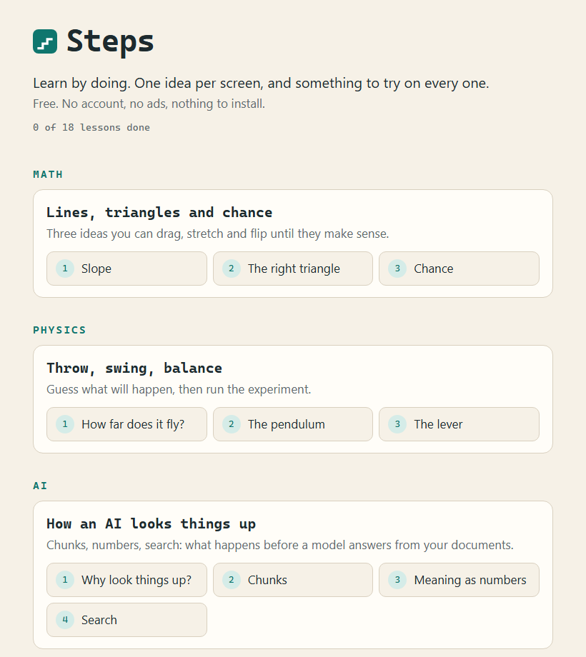
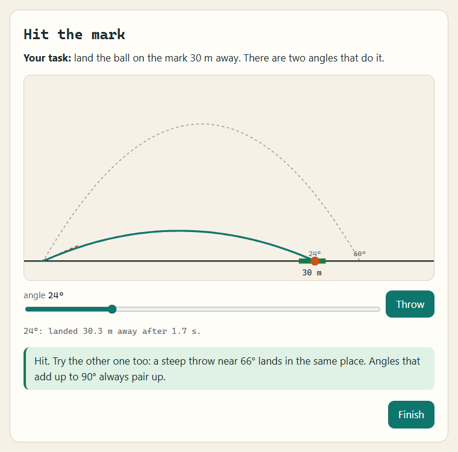
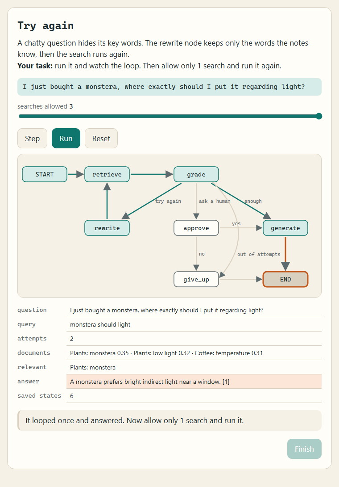

# Steps

**Learn by doing. Free, for everyone.** → **https://hclivess.github.io/steps/**

Short interactive lessons in math, physics and AI. One idea per screen, and on every screen something to drag,
throw, break or predict before you are told the answer. No account, no ads, nothing to install: it is a plain web page.



| Throw a ball, then hit the mark | Watch a graph loop and decide |
| --- | --- |
|  |  |

## What is in it now

| Subject | Course | Lessons |
| --- | --- | --- |
| Math | Numbers for every day | Solving equations · Negative numbers · The coordinate plane · Percents · Proportion |
| Math | Lines, triangles and chance | Slope · The right triangle · Chance |
| Math | Fractions, functions, dice | Fractions · Functions · Two dice |
| Physics | Throw, swing, balance | How far does it fly? · The pendulum · The lever |
| Physics | Waves, circuits, orbits | Waves · Circuits · Orbits |
| AI | How an AI looks things up | Why look things up? · Chunks · Meaning as numbers · Search |
| AI | Chains | A chain is a pipe · Order matters · Swap a part · Streaming |
| AI | Graphs that decide | State · The graph decides · Loops · A human in the loop |

29 lessons, 66 screens. This is a start, not the whole of "everything": the site is built so that a new subject is one more file. What comes next is listed in [the roadmap](https://github.com/hclivess/steps/issues/1).

## How a lesson works

- **Predict first.** You guess, then the experiment shows what happens.
- **A task, not a text.** "Make the slope exactly 2." "Hit the mark 30 m away." "Make the chain run." Continue lights up when you have done it.
- **Nothing is faked.** Every picture and every "correct" is computed on the spot from the formula or the small engine in `js/`. The answers are not typed into the lessons.

The AI lessons use a toy model and a toy word-counting embedder so that everything runs in the page. The lessons say so where it matters.
The same ideas with the real libraries, in Python: [rag-steps](https://github.com/hclivess/rag-steps),
[langchain-steps](https://github.com/hclivess/langchain-steps), [langgraph-steps](https://github.com/hclivess/langgraph-steps).

## Add a lesson

Plain JavaScript, no build step, no framework. A lesson is a list of screens:

```js
{ id: 'lever', title: 'The lever', screens: [
  { title: 'Balance it',
    text: 'A 6 kg weight sits 2 m left of the pivot.<br><b>Your task:</b> slide the 4 kg weight until the beam is level.',
    mount(host, api) { /* draw into host; call api.solve('why it is right') when the task is done,
                          api.miss('hint') for a wrong try, api.note('…') for a remark */ } },
] }
```

1. Put the formulas in `js/science.js` (or a new file) as pure functions, and a test in `test/` that proves the task can be solved.
2. Write the screens in `js/lessons/<subject>.js` with the helpers in `js/ui.js` (`h`, `svg`, `choice`, `slider`, `drag`, `bars`).
3. List a new subject file in `js/lessons/index.js`.

```
js/app.js            home page, lesson runner, progress (kept in your browser only)
js/ui.js             buttons, sliders, drawings
js/science.js        math and physics formulas
js/core.js           chunking, search, a chain of parts, a graph engine
js/data.js           the nine notes the AI lessons search
js/lessons/          the lessons, one file per subject
test/                node --test test/core.test.mjs test/science.test.mjs test/lessons.test.mjs
```

To run it on your own computer the page has to come from a web server (browsers do not load script modules from a
double-clicked file): `python -m http.server` in this folder, then open http://localhost:8000. Or just use the link at the top.

## License

MIT. Use it, change it, teach with it.
